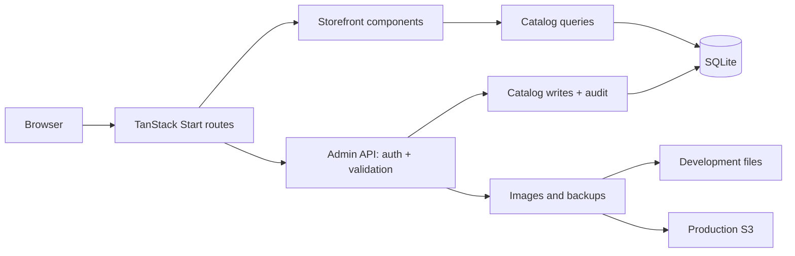
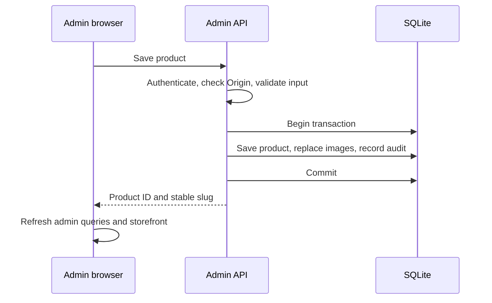
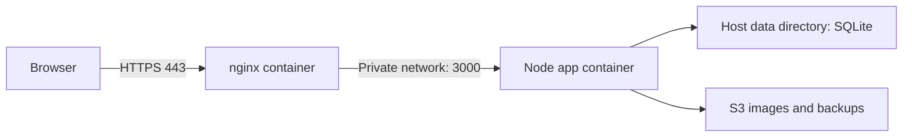

# Beauty Code

Georgian product storefront and catalog admin, built with React, TanStack Start, SQLite and Tailwind CSS. Customers browse and contact the shop through chat; there is no checkout or customer-account system.

## Local development

Use Node 26 and pnpm. Run commands from the repository root.

```sh
pnpm install
pnpm dev
```

Open <http://localhost:3000> or <http://localhost:3000/admin>. Admin credentials are **admin / admin**. To change the local password:

```sh
DEV_ADMIN_PASSWORD=your-password pnpm dev
```

Development needs no nginx or AWS credentials. AWS packages remain installed for production and load when cloud operations are used. Keep the development server on localhost. The root `.env` configures production; local development needs no AWS setup.

| Data | Development | Production |
| --- | --- | --- |
| Authentication | App Basic Auth, `admin / admin` | nginx Basic Auth |
| Catalog | `data-dev/beautycode.db` | `data/beautycode.db` |
| New images | `public/images/dev-*` | S3 through signed uploads; CloudFront delivery |
| Admin backups | `data-dev/backups/*.db` | S3 backup bucket |

`NODE_ENV=development` enables local behavior; Vite sets this for `pnpm dev`. `DB_PATH` overrides the database location. Production credentials and storage never fall back to the development defaults.

### Reset development data

Stop the dev server first (`Ctrl+C`). Then:

```sh
rm -rf data-dev
rm -f public/images/dev-*
rm -f backups/beautycode-*.json backups/latest.json
```

This deletes local catalog edits, development uploads and generated local backups. On the next request, migrations create a fresh catalog with the six bundled products. It leaves `data/` and the bundled images intact. If you override `DB_PATH`, manage that file separately.

### Local backup and restore

After the app has initialized the development database:

```sh
pnpm backup:dev
```

Stop the app before restoring:

```sh
pnpm restore:dev data-dev/backups/beautycode-TIMESTAMP-ID.db --replace
```

Backups contain catalog data and image references, not image files. Preserve `public/images/dev-*` separately when saving a development catalog. Use the actual filename printed by the backup command. Restore checks SQLite integrity, references and schema version, and saves the existing database before replacement. `backup:dev` and `restore:dev` select the same local database as `pnpm dev`.

## Architecture





| Location | Responsibility |
| --- | --- |
| `src/routes/` | Pages and HTTP endpoints |
| `src/components/` | Storefront and admin UI; editors own form state |
| `src/lib/admin/` | Browser API calls, form conversion and shared validation |
| `src/server/admin/` | Authentication, HTTP errors and catalog persistence |
| `src/server/` | Database, migrations, backups and local/cloud storage |
| `migrations/` | Versioned schema and initial catalog |
| `scripts/` | Backup, restore and image publishing commands |
| `cloudformation.yml` | AWS image storage, backups and instance role |
| `nginx.conf` | Production HTTPS proxy and admin authentication |
| `docker-compose.yaml` | Production app and nginx containers |
| `Dockerfile` | Production Node image |
| `tests/` | Catalog, authorization, storage, backup and SEO checks |

Seeding is part of the existing versioned migrations and runs once per database. Startup never re-applies seeds or overwrites catalog edits. Keep applied migrations unchanged; add a new migration for future schema changes. Deleting the development database resets it to the bundled catalog.

Form sections and tables are plain components. Database writes use explicit SQL transactions. Local and cloud storage share image validation, with no provider registry or extra service framework. `src/routeTree.gen.ts` is generated; edit route files instead.

## Checks

```sh
pnpm exec tsc --noEmit
pnpm exec biome check src scripts tests
pnpm test
pnpm build
```

For a bundled server outside Docker, set `MIGRATIONS_DIR` to the absolute path of the `migrations` directory before starting it. Docker sets `/app/migrations`; native scripts and development resolve migrations relative to the source module.

Tests use temporary or in-memory databases. The build may emit upstream `use client` bundler warnings.

## Production deployment

One `docker-compose.yaml` runs the app and nginx. `Dockerfile` builds the app; the root `nginx.conf` handles HTTPS and admin authentication. Local development uses `pnpm dev`.



### First setup

Install Docker with Compose, Certbot and `htpasswd` on your EC2 host. Point your domain to the host and allow inbound 80/443. Keep the checkout and `data/` on persistent storage.

Create AWS storage with the single root template:

```sh
aws cloudformation deploy \
  --template-file cloudformation.yml \
  --stack-name beautycode-storage \
  --parameter-overrides SiteOrigin=https://beautycode.ge \
  --capabilities CAPABILITY_IAM \
  --region eu-central-1
aws cloudformation describe-stacks --stack-name beautycode-storage --query 'Stacks[0].Outputs'
```

The stack creates private image and backup buckets, CloudFront and an EC2 instance profile. Attach the profile to your existing host. Require IMDSv2 with response hop limit 2 so the app container can obtain role credentials. The template does not create the host or DNS records.

```sh
mkdir -p secrets data
htpasswd -B -c secrets/htpasswd admin
sudo chown 1000:1000 data
```

On a fresh checkout, copy `.env.example` to `.env`. Keep existing `.env` values when upgrading. Edit `.env` and set `DOMAIN`, `SITE_URL`, `AWS_REGION`, `S3_IMAGES_BUCKET`, `S3_BACKUPS_BUCKET` and `IMAGES_BASE_URL` in `.env`. The configured bucket names are `beautycode-ge-images` and `beautycode-ge-backups`. Set `IMAGES_BASE_URL` from the stack’s `ImagesBaseUrl` output after deployment. Bucket name availability is checked by AWS during deployment. Compose supplies the production runtime settings and passes `SITE_URL` into the build for canonical URLs. No AWS access keys are needed with the instance profile.

Obtain the first certificate while port 80 is free, then start production:

```sh
sudo certbot certonly --standalone -d beautycode.ge
sudo mkdir -p /var/www/html
docker compose up -d --build
docker compose exec nginx nginx -t
```

Use your actual domain in the Certbot command. Compose automatically loads `docker-compose.yaml`; the nginx Docker entrypoint substitutes `DOMAIN` from `.env`. Compose mounts `nginx.conf` as `/etc/nginx/templates/default.conf.template`, which is rendered into `/etc/nginx/conf.d/default.conf` before nginx starts. The filter preserves native nginx variables such as `$host` and `$request_uri`; nginx itself does not read `.env`. Only nginx exposes host ports. The app applies migrations and passes its health check before nginx starts. SQLite persists in `./data`, mounted at `/data` in the container.

### Certificate renewal

After nginx starts, switch Certbot to the shared webroot and check renewal:

```sh
sudo certbot reconfigure --cert-name beautycode.ge --webroot -w /var/www/html
sudo certbot renew --dry-run
```

Use the host's Certbot renewal timer. Configure a deploy hook to run `docker compose -f /srv/beautycode/docker-compose.yaml exec -T nginx nginx -s reload` after renewal; adjust the checkout path. Mounting the entire certificate directory lets nginx read renewed certificates.

### Releases

From the checkout:

```sh
docker compose exec -T app node scripts/backup.ts
docker compose up -d --build
```

### Backups and restore

The admin button and CLI use the same SQLite snapshot function. Snapshots contain the full database, including indexes, triggers, search data and migration version. Each backup has one timestamped key; there is no `latest` duplicate.

Production first writes to `/data/backups/`, then streams that file to S3. It deletes the local snapshot only after upload succeeds; failed uploads leave it available for recovery. S3 lifecycle rules retain backups for 30 days. Development snapshots remain local until you remove them. For an explicit local snapshot:

```sh
docker compose exec -T app node scripts/backup.ts /data/export.db
```

Stop writes before restoring:

```sh
docker compose stop app
docker compose run --rm --no-deps app node scripts/restore.ts s3:backups/beautycode-TIMESTAMP-ID.db --replace
docker compose up -d app
```

Replace the example key with the actual key returned by the backup command or listed in the S3 console. Use `/data/export.db` instead of the S3 source for a local snapshot. Existing output files are never overwritten by the backup command.

Stop the app before restoring. Restore validates the snapshot before touching the destination, saves a `*.before-restore-*.db` safety copy, and uses SQLite’s backup API to replace the database. SQLite handles WAL files; do not manually copy or delete them. The snapshot must match the current schema version. Restart only after success. Snapshots contain image references, not image files.

Optional daily backup cron entry (adjust the checkout path):

```cron
0 3 * * * cd /srv/beautycode && docker compose exec -T app node scripts/backup.ts
```

### Images

The bundled images work immediately. New admin uploads go directly to S3 through signed POST requests and are served by CloudFront. Removing a gallery image removes its catalog reference, not the S3 object.

Bundled images stay bundled; only new admin uploads use S3. There is no separate image-publishing step.

### Existing JSON backups

New backups use SQLite files. Keep old JSON backups until you have verified a new snapshot. To convert one, restore it into a separate temporary database using the previous release, then use the current backup command:

```sh
git worktree add --detach /tmp/beautycode-json-restore 901c88c
cd /tmp/beautycode-json-restore
pnpm install --frozen-lockfile
DB_PATH=/tmp/beautycode-converted.db pnpm restore /absolute/path/old-backup.json --replace
```

Return to the current checkout and create the new snapshot:

```sh
DB_PATH=/tmp/beautycode-converted.db pnpm backup /tmp/beautycode-converted-snapshot.db
```

The old release supports `s3:backups/latest.json` as a source when its AWS environment is configured. Run conversion against a new temporary database, never the live production file. Restore the converted snapshot through the normal stopped-app procedure above. This keeps legacy JSON handling out of the current application.
