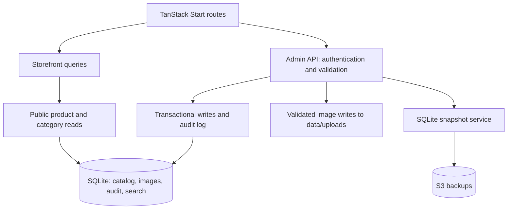
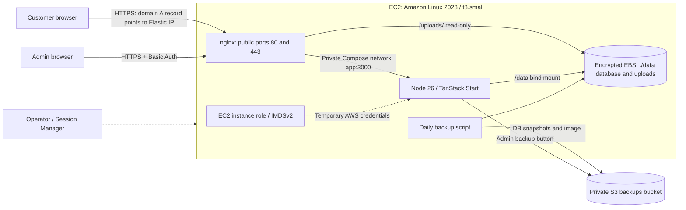
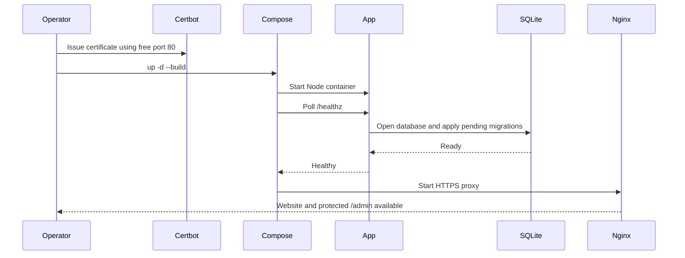
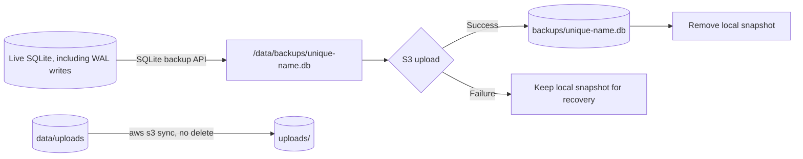
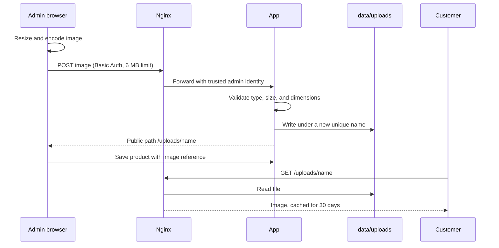

# Beauty Code

Georgian product storefront and catalog admin built with React, TanStack Start, SQLite, and Tailwind CSS. Customers browse products and contact the shop through chat. There is no checkout or customer-account system.

- [Local development](#local-development)
- [Application architecture](#application-architecture)
- [Production deployment](#production-deployment)
- [Releases and infrastructure updates](#releases-and-infrastructure-updates)
- [Backups and recovery](#backups-and-recovery)
- [Troubleshooting](#troubleshooting)

## Local development

Use Node 26.13 and pnpm 12.16.1. Run commands from the repository root:

```sh
pnpm install --frozen-lockfile
pnpm dev
```

Open <http://localhost:3000> or <http://localhost:3000/admin>. Development admin has no login prompt and is **read-only**: browsing, searching, and filtering work; saves, uploads, and admin backup requests are disabled. Keep the development server on localhost.

| Behavior             | Development                     | Production with Docker Compose                                  |
| -------------------- | ------------------------------- | --------------------------------------------------------------- |
| Admin authentication | No login; reads only            | nginx Basic Auth                                                |
| Database             | `data/beautycode.db` by default | Host `./data/beautycode.db`, mounted as `/data/beautycode.db`   |
| Admin writes         | Rejected by the API             | Authenticated, same-origin requests                             |
| Image uploads        | Disabled                        | Written to `./data/uploads/` and served by nginx at `/uploads/` |
| CLI backup           | Local `data/backups/*.db`       | Upload to S3; local snapshot removed after success              |

Vite sets `NODE_ENV=development`. Development browsing needs no AWS credentials. `DB_PATH` overrides the native database path. Development and production **do not automatically use separate databases**. To use an isolated development catalog:

```sh
DB_PATH=data-dev/beautycode.db pnpm dev
```

Use that same `DB_PATH` for backup and restore commands. Do not run development and production against the same live file.

### Schema and reset

[`migrations/0001_init.sql`](migrations/0001_init.sql) creates the complete schema and seeds six products and four categories. Migrations run when the database is first opened; applied migrations never run again. For future schema changes, add a numbered migration instead of editing an applied one.

This repository now uses a **fresh schema-version-1 baseline**. Databases and snapshots from the previous three-migration history must not be reused. For a disposable local database, stop every process using it, then reset it:

```sh
# Deletes the default local catalog and its SQLite sidecars.
rm -f data/beautycode.db data/beautycode.db-wal data/beautycode.db-shm
pnpm dev
```

Adjust these paths if you set `DB_PATH`. This loses local catalog edits. Do not use this reset procedure for production recovery; use [snapshot restore](#restore-a-snapshot). Bundled images and existing backup files remain intact.

### Local backup and restore

After visiting the app once to initialize the database:

```sh
pnpm backup:dev
```

Stop the app before restoring. Substitute the actual filename printed by the backup command:

```sh
pnpm restore:dev data/backups/beautycode-TIMESTAMP-ID.db --replace
```

For an isolated database, prefix both commands with `DB_PATH=data-dev/beautycode.db`. The CLI creates a safety copy before replacing an existing database. Snapshots contain catalog data and image references, not image files.

### Checks

```sh
pnpm typecheck
pnpm exec biome check src scripts tests
pnpm test
pnpm build
```

Terraform checks used in GitHub Actions can also be run locally:

```sh
terraform fmt -check -recursive infra/terraform
terraform -chdir=infra/terraform init -backend=false
terraform -chdir=infra/terraform validate
```

Tests use temporary or in-memory databases. Builds may emit upstream `use client` bundler warnings. When running a bundled server outside Docker, set `MIGRATIONS_DIR` to the absolute path of the checkout's `migrations` directory.

## Application architecture



Public queries return only published products in active categories. Draft and archived products remain in admin and are unavailable through public product URLs. Stock status is separate: preorder remains visible, while out-of-stock products remain visible with the order button disabled.

Product saves validate input, update product fields and gallery references, and record an audit entry in one transaction. Search triggers keep SQLite FTS synchronized. Existing product slugs remain stable when names change.

| Location                            | Responsibility                                                          |
| ----------------------------------- | ----------------------------------------------------------------------- |
| `src/routes/`                       | Pages, loaders, and HTTP endpoints                                      |
| `src/components/admin/`             | Admin overview, filters, tables, and editors                            |
| `src/components/ui/`                | Shared Tailwind-styled primitives, including Radix dropdowns            |
| `src/lib/admin/`                    | Browser API calls, image optimization, form conversion, validation      |
| `src/server/admin/`                 | Authentication, error responses, persistence, and audit                 |
| `src/server/`                       | Database reads, migrations, snapshots, upload storage, and S3 backups   |
| `src/styles.css`                    | Theme tokens, base styles, and reduced-motion defaults                  |
| `migrations/`                       | Versioned SQL schema and initial catalog                                |
| `scripts/`                          | SQLite backup and restore CLI; `backup.sh` and `deploy.sh` for the host |
| `infra/terraform/`                  | VPC, EC2 host, instance role, Elastic IP, and S3 backups bucket         |
| `docker-compose.yaml`, `Dockerfile` | Production containers and app build                                     |
| `nginx.conf`                        | TLS, proxying, admin authentication, and `/uploads/`                    |
| `tests/`                            | Catalog, authorization, backup, search, and SEO checks                  |

Component styling lives in Tailwind classes. Edit route files rather than generated `src/routeTree.gen.ts`.

## Production deployment

The deployment uses one EC2 host and one app process. SQLite and uploaded product images live on the host disk, outside the containers. Recreating containers preserves them; replacing the EC2 instance requires data recovery. This is a single-host deployment, without a load balancer, CDN, or automatic failover.



nginx serves the website through the app, and serves uploaded product images directly from disk. The app's port 3000 is not published on the host. nginx sets the trusted admin identity header only after authentication; do not expose the app directly.

### 1. Prepare AWS and DNS inputs

Use an AWS account with permission to create VPC, EC2, IAM, and S3 resources. Set a budget alert before deploying. You need AWS credentials and control of the website domain's DNS records. Terraform creates the VPC and subnet, so you do not need to find or supply VPC, subnet, or instance IP IDs.

### 2. Create the infrastructure with Terraform

Install Terraform 1.17 or newer and configure AWS credentials using the AWS CLI profile, environment, or another standard provider method. From the repository root:

```sh
cd infra/terraform
cp terraform.tfvars.example terraform.tfvars
# Edit terraform.tfvars and set the real domain.
terraform init
terraform fmt -check
terraform validate
terraform plan -out=beautycode.tfplan
terraform apply beautycode.tfplan
terraform output -raw public_ip
terraform output -raw instance_id
terraform output -raw backups_bucket
```

Terraform provisions its own public VPC, subnet, internet gateway, route, security group, EC2 host, Elastic IP, Session Manager role, and encrypted/versioned S3 backup bucket. EC2 user data installs Docker, Git, `htpasswd`, cron, and swap; the Amazon Linux 2023 AMI supplies AWS CLI v2. Terraform does not deploy application code or create DNS records because DNS may be hosted outside AWS. Record the three output values: add a DNS A record for `public_ip`, use `instance_id` to connect with Session Manager, and set `.env`'s `S3_BACKUPS_BUCKET` to `backups_bucket`. Set `AWS_REGION` to `aws_region` from `terraform.tfvars`. `instance_type` defaults to `t3.small` and `root_volume_size` defaults to 30 GiB; both can be changed in `terraform.tfvars`. App deployment, TLS certificates, certificate renewal, and scheduled backups are configured in the following steps, not by Terraform.

The bucket name includes the AWS account and region to avoid the old fixed global name. Terraform uses local state at `infra/terraform/terraform.tfstate`; back it up securely and keep it private so later plans can track the resources it created. Do not delete the state or run `terraform destroy` against a live site. This configuration creates replacement infrastructure and does not adopt or migrate resources from an existing CloudFormation stack. If a CloudFormation stack already exists, do not apply this configuration until you have planned the migration and data recovery; applying it as-is can create duplicate infrastructure, and the new bucket will not contain old backups. Only ports 80 and 443 are open inbound; administer through Session Manager. IMDSv2 is required.

### 3. Prepare the EC2 host

Connect using the EC2 console's **Connect → Session Manager**. Wait for first boot to finish, then verify the services:

```sh
sudo cloud-init status --wait
sudo systemctl status docker crond
```

Terraform's user data installs Docker, Git, `htpasswd`, cron, and swap. The Amazon Linux 2023 AMI includes AWS CLI v2. Install the [Docker Compose CLI plugin](https://docs.docker.com/compose/install/linux/) for all users so `sudo docker compose` works. Install Certbot using a method appropriate for the host; the [Certbot Python virtual-environment instructions](https://certbot.eff.org/instructions?os=pip&ws=nginx) are one option. This deployment uses `certonly`, not Certbot's automatic nginx configuration, because nginx runs inside Docker.

Verify the tools and the swap file before continuing:

```sh
sudo docker compose version
sudo certbot --version
git --version
aws --version
swapon --show
```

Clone the repository and check out the release you intend to deploy:

```sh
sudo mkdir -p /srv/beautycode
sudo chown "$(id -u):$(id -g)" /srv/beautycode
git clone <REPOSITORY_URL> /srv/beautycode
cd /srv/beautycode
git checkout <RELEASE_TAG_OR_COMMIT>
chmod +x scripts/*.sh
mkdir -p secrets data/uploads
htpasswd -B -c secrets/htpasswd admin
sudo chown -R 1000:1000 data
```

Replace the angle-bracket placeholders before running these commands. The app container runs as UID 1000, which must be able to write the host data directory and `data/uploads`. Create `data/uploads` yourself, as above: if Docker creates it, it is owned by root and uploads fail. Use `htpasswd -B secrets/htpasswd admin` to change the password later; omit `-c` so you do not recreate the password file.

### 4. Configure the application and DNS

On a fresh checkout only:

```sh
cp .env.example .env
chmod 600 .env
```

Edit `.env` with your real `DOMAIN` and the Terraform outputs recorded in step 2. Replace the `S3_BACKUPS_BUCKET` placeholder with the recorded `backups_bucket` value. Preserve `.env` when updating releases.

| Variable            | Example / source            | Purpose                                                |
| ------------------- | --------------------------- | ------------------------------------------------------ |
| `DOMAIN`            | `beautycode.ge`             | nginx hostname; Compose derives the app's HTTPS origin |
| `AWS_REGION`        | Terraform `aws_region`      | Same region as the infrastructure                      |
| `S3_BACKUPS_BUCKET` | Terraform `backups_bucket`  | Database snapshots and image backups                   |
| `DB_PATH`           | `/data/beautycode.db`       | SQLite file; set by Compose                            |
| `UPLOADS_DIR`       | `/data/uploads`             | Uploaded images; set by Compose                        |
| `MIGRATIONS_DIR`    | `/app/migrations` in Docker | SQL directory inside the container                     |

The server parses environment variables with Zod on the first request and reports invalid values. Production requires `SITE_URL`, `AWS_REGION`, `S3_BACKUPS_BUCKET`, `DB_PATH`, and `UPLOADS_DIR`; Compose derives `SITE_URL` and the build's `VITE_SITE_URL` from `DOMAIN`. Compose overrides `MIGRATIONS_DIR` with `/app/migrations` inside the container. It also sets `NODE_ENV`, `HOST`, `PORT`, `DB_PATH`, and `UPLOADS_DIR`. Changing `DOMAIN` updates nginx and the app's canonical origin on the next build and restart.

Use the instance role rather than adding AWS access keys to `.env`. Set the domain's A record to `terraform output -raw public_ip`. The browser origin must match the origin derived from `DOMAIN` for admin writes. Configure only DNS records for addresses this host actually serves; a stale AAAA record can send clients and certificate validation to another host.

### 5. Issue the first certificate and start containers

Wait for DNS to point to the Elastic IP. With port 80 free, run on EC2:

```sh
cd /srv/beautycode
sudo certbot certonly --standalone -d beautycode.ge
sudo mkdir -p /var/www/html
sudo docker compose config --quiet
sudo docker compose up -d --build
sudo docker compose ps
sudo docker compose exec -T nginx nginx -t
curl --fail https://beautycode.ge/healthz
```

Use your actual domain throughout. The certificate must exist before nginx starts because its configuration references `/etc/letsencrypt/live/DOMAIN/`. Expected health response: `{"status":"ok"}`.



The nginx container renders `nginx.conf` with `DOMAIN` on startup. `NGINX_ENVSUBST_FILTER` preserves nginx's own `$host` and `$request_uri` variables. The app health check exercises the database before nginx starts.

Verify storefront browsing, `/admin` authentication, a product edit, and an image upload. Confirm the uploaded image loads from `https://beautycode.ge/uploads/...` and that the file exists under `data/uploads/`. A successful health check does not validate uploads or backups, so also run `./scripts/backup.sh` once by hand.

### 6. Configure certificate renewal

After nginx starts, use its shared ACME webroot for future renewals:

```sh
sudo certbot reconfigure --cert-name beautycode.ge --webroot -w /var/www/html
sudo certbot renew --dry-run
```

Configure a Certbot deploy hook that reloads nginx after a successful renewal. Save this as `/etc/letsencrypt/renewal-hooks/deploy/beautycode-nginx` and make it executable:

```sh
#!/bin/sh
set -eu
cd /srv/beautycode
/usr/bin/docker compose exec -T nginx nginx -s reload
```

Enable the renewal timer or scheduled job provided by your Certbot installation. If the installation method does not create one, add a root cron job (adjust the executable path returned by `command -v certbot`):

```cron
17 2,14 * * * /usr/local/bin/certbot renew --quiet
```

Use one renewal schedule. Mounting the entire `/etc/letsencrypt` directory makes renewed certificate files available in nginx; the deploy hook reloads them into the running process.

### 7. Schedule backups

Add the daily backup to root's crontab (`sudo crontab -e`). The schedule uses the host timezone:

```cron
0 3 * * * /srv/beautycode/scripts/backup.sh >> /var/log/beautycode-backup.log 2>&1
```

Check the log after the first run and rotate it. See [Backups and recovery](#backups-and-recovery).

## Releases and infrastructure updates

For an application release, run from the EC2 checkout:

```sh
cd /srv/beautycode
./scripts/deploy.sh <RELEASE_TAG_OR_COMMIT>
```

The script backs up the database and images, checks out the release, builds the image, restarts the app, and polls `/healthz`. It stops at the first failure, and a failed build leaves the running app and the previous checkout in place. The build happens on the host; Terraform creates a 2 GiB swap file to reduce the chance of running out of memory on `t3.small`. This deployment does not guarantee zero downtime.

To roll back, run the script with the previous tag or commit, which it prints when it finishes or fails. Review schema migrations before release; rolling back code alone may not work after a schema change. Restore a snapshot compatible with the rollback release if needed.

Review `terraform plan` before infrastructure updates. The configuration ignores changes to the AMI and user data, so it will not automatically replace the host when the latest AMI changes. If you intentionally replace the instance, Terraform retains its root EBS disk but does not attach that disk to the replacement. The new host starts with an empty data directory; restore the database and images from S3 before serving traffic. Retained disks and buckets continue to incur charges until explicitly removed.

Do not run independent writable copies of the same catalog behind the same domain.

## Backups and recovery

Two things need backing up: the **database** (snapshotted by the app) and the **uploaded product images** (synced to S3 by the host script). `scripts/backup.sh` does both:

```sh
cd /srv/beautycode
./scripts/backup.sh
```



Snapshots include schema, catalog, galleries, search data, and audit history. They do not contain image files, `.env`, admin passwords, or certificates. S3 lifecycle rules expire database snapshots (`backups/`) after 30 days and noncurrent versions after 30 noncurrent days. Images under `uploads/` are never expired, and images removed in the admin stay in the backup. Development snapshots remain local until manually removed.

To write only an explicit local database export without uploading it:

```sh
sudo docker compose exec -T app node scripts/backup.ts /data/export.db
```

Existing output files are never overwritten. Monitor `/var/log/beautycode-backup.log` for failures. Scheduling and monitoring are not created by Terraform. Because uploaded images exist only on the host disk and in this S3 copy, a silently failing backup is the main risk of this setup.

### Restore a snapshot

Choose the actual S3 key printed by a successful backup or view it in the S3 console. The app role can read and write backup objects, and can list only the `uploads/` prefix.

Stop the app to prevent concurrent writes, restore the database using the built app image, then restore the images:

```sh
cd /srv/beautycode
set -a; . ./.env; set +a
sudo docker compose stop app
sudo docker compose run --rm --no-deps app \
  node scripts/restore.ts s3:backups/beautycode-TIMESTAMP-ID.db --replace
mkdir -p data/uploads
aws s3 sync "s3://${S3_BACKUPS_BUCKET}/uploads/" ./data/uploads --region "$AWS_REGION"
sudo chown -R 1000:1000 data/uploads
# Restart only after both steps succeed.
sudo docker compose up -d app
curl --fail https://beautycode.ge/healthz
```

For a local export, replace the `s3:...` source with `/data/export.db`. Restore validates integrity, foreign keys, required tables, and schema version before touching the destination. It saves an existing database as `*.before-restore-*.db` before replacement. SQLite handles WAL files; do not manually copy or delete live database sidecars during recovery.

For a lost or replacement host, repeat host setup, restore `.env` and admin credentials, obtain certificates, and build the app image. Restore the compatible snapshot and images into the data mount before starting the stack. Do a restore drill once in a while: restore the latest snapshot into an isolated `DB_PATH` and open it.

### Image storage

Bundled images ship with the app. Images added in the admin are resized and encoded in the browser, then uploaded to the app through nginx. The app validates the file and writes it to `data/uploads/`; nginx serves it from disk at `/uploads/<name>`.



Rules the upload code must follow, because files are served from the same origin as the site:

- Check the real file type from its contents, not the filename or client-supplied type, and accept only raster images (JPEG, PNG, WebP, AVIF). Do not accept SVG.
- Enforce a size limit in the app (smaller than nginx's 6 MB).
- Generate the filename on the server (random, with a fixed extension). Never reuse a name or use any part of the client's filename or path.
- Write to a temporary name, then rename, so nginx never serves a partial file.

nginx caches `/uploads/` as `immutable` for 30 days, which is safe only because a name is never reused. Removing a gallery image removes its database reference, not the file. There is no separate bundled-image publishing command.

## Troubleshooting

Start with these commands from the EC2 checkout:

```sh
sudo docker compose ps
sudo docker compose logs --tail=100 app nginx
sudo docker compose exec -T nginx nginx -t
```

| Symptom                                           | Check                                                                                                            |
| ------------------------------------------------- | ---------------------------------------------------------------------------------------------------------------- |
| `/healthz` returns 503 or app is unhealthy        | App logs, `data/` ownership (UID 1000), migration directory, and database version                                |
| New baseline rejects the local database           | Stop the local app and reset the disposable old database; do not relabel its schema version                      |
| nginx cannot start                                | Certificate paths, `DOMAIN`, `secrets/htpasswd`, and whether ports 80/443 are already occupied                   |
| 502 after restarting the app                      | App health and logs; nginx resolves the Compose service name periodically                                        |
| Session Manager cannot connect                    | Instance profile, SSM agent, subnet route, and outbound access to SSM endpoints                                  |
| Admin loads but cannot save locally               | Expected: development admin is read-only                                                                         |
| Production admin returns 403 on save              | Browser origin must match the HTTPS origin derived from `DOMAIN`; access through authenticated nginx             |
| Upload fails with 413                             | nginx's 6 MB admin limit or the app's own size limit; resize the image                                           |
| Upload fails with a permission error              | `data/uploads` must exist and be owned by UID 1000 (`sudo chown -R 1000:1000 data`)                              |
| Uploaded image returns 404                        | File exists in `data/uploads`; nginx mounts `./data/uploads` at `/srv/uploads`; path starts with `/uploads/`     |
| Uploaded image returns 403                        | File permissions: files must be world-readable (mode 644) so the nginx container can read them                   |
| Backup fails                                      | S3 bucket/region, role credentials, `aws` on the host, and free disk space; failed uploads leave local snapshots |
| Build is killed on `t3.small`                     | Confirm swap with `swapon --show`; if missing, review the instance's user data or use `t3.medium`                |
| Certificate renewal fails                         | DNS, port 80 access, shared webroot, renewal schedule, and deploy hook                                           |
| Hydration warning mentions `data-protonpass-form` | Test with the password-manager extension disabled or in a clean browser profile                                  |
