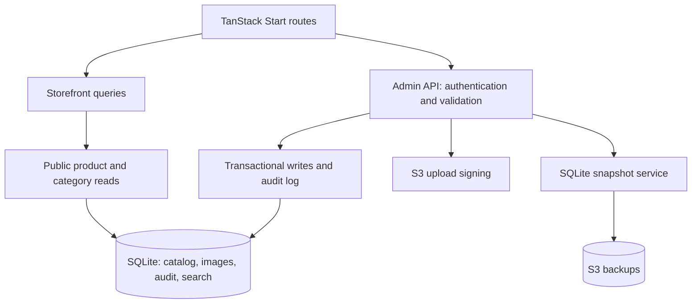
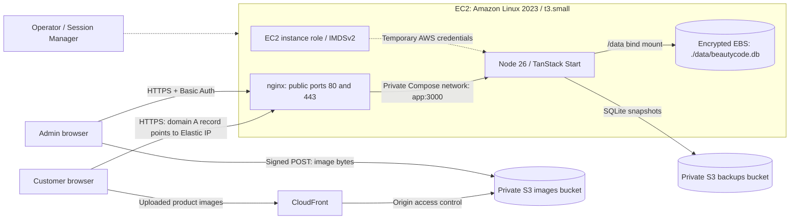
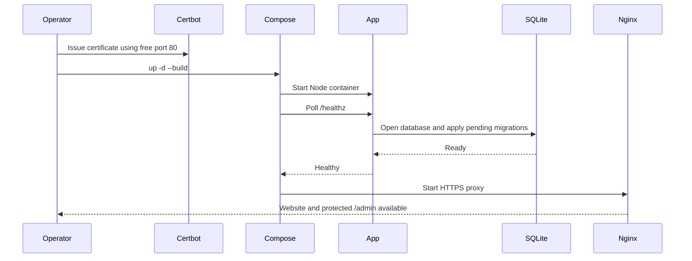
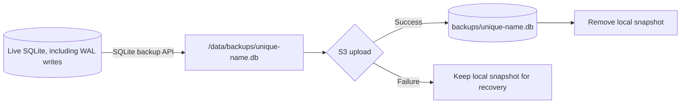
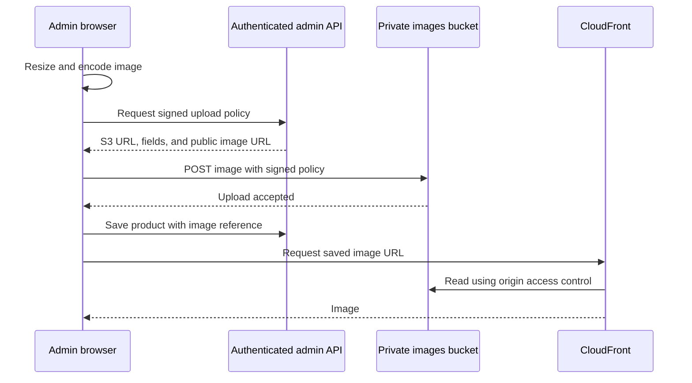

# Beauty Code

Georgian product storefront and catalog admin built with React, TanStack Start, SQLite, and Tailwind CSS. Customers browse products and contact the shop through chat. There is no checkout or customer-account system.

- [Local development](#local-development)
- [Application architecture](#application-architecture)
- [Production deployment](#production-deployment)
- [Releases and infrastructure updates](#releases-and-infrastructure-updates)
- [Backups and recovery](#backups-and-recovery)
- [Troubleshooting](#troubleshooting)

## Local development

Use Node 26 and pnpm. Run commands from the repository root:

```sh
pnpm install --frozen-lockfile
pnpm dev
```

Open <http://localhost:3000> or <http://localhost:3000/admin>. Development admin has no login prompt and is **read-only**: browsing, searching, and filtering work; saves, uploads, and admin backup requests are disabled. Keep the development server on localhost.

| Behavior | Development | Production with Docker Compose |
| --- | --- | --- |
| Admin authentication | No login; reads only | nginx Basic Auth |
| Database | `data/beautycode.db` by default | Host `./data/beautycode.db`, mounted as `/data/beautycode.db` |
| Admin writes | Rejected by the API | Authenticated, same-origin requests |
| Image uploads | Disabled | Browser uploads directly to private S3 using a signed POST |
| CLI backup | Local `data/backups/*.db` | Upload to S3; local snapshot removed after success |

Vite sets `NODE_ENV=development`. Development browsing needs no AWS credentials. `DB_PATH` overrides the native database path. Development and production **do not automatically use separate databases**. To use an isolated development catalog:

```sh
DB_PATH=data-dev/beautycode.db pnpm dev
```

Use that same `DB_PATH` for backup and restore commands. Do not run development and production against the same live file.

### Schema and reset

[`migrations/0001_init.sql`](migrations/0001_init.sql) creates the complete schema and seeds six products and four categories. Migrations run when the database is first opened; applied migrations never run again. For future schema changes, add a numbered migration instead of editing an applied one.

This repository now uses a **fresh schema-version-1 baseline**. Databases and snapshots from the previous three-migration history must not be reused. For a disposable local database, stop every process using it, then reset it:

```sh
# Deletes the default local catalog and its SQLite sidecars.
rm -f data/beautycode.db data/beautycode.db-wal data/beautycode.db-shm
pnpm dev
```

Adjust these paths if you set `DB_PATH`. This loses local catalog edits. Do not use this reset procedure for production recovery; use [snapshot restore](#restore-a-snapshot). Bundled images and existing backup files remain intact.

### Local backup and restore

After visiting the app once to initialize the database:

```sh
pnpm backup:dev
```

Stop the app before restoring. Substitute the actual filename printed by the backup command:

```sh
pnpm restore:dev data/backups/beautycode-TIMESTAMP-ID.db --replace
```

For an isolated database, prefix both commands with `DB_PATH=data-dev/beautycode.db`. The CLI creates a safety copy before replacing an existing database. Snapshots contain catalog data and image references, not image files.

### Checks

```sh
pnpm typecheck
pnpm exec biome check src scripts tests
pnpm test
pnpm build
```

Tests use temporary or in-memory databases. Builds may emit upstream `use client` bundler warnings. When running a bundled server outside Docker, set `MIGRATIONS_DIR` to the absolute path of the checkout's `migrations` directory.

## Application architecture



Public queries return only published products in active categories. Draft and archived products remain in admin and are unavailable through public product URLs. Stock status is separate: preorder remains visible, while out-of-stock products remain visible with the order button disabled.

Product saves validate input, update product fields and gallery references, and record an audit entry in one transaction. Search triggers keep SQLite FTS synchronized. Existing product slugs remain stable when names change.

| Location | Responsibility |
| --- | --- |
| `src/routes/` | Pages, loaders, and HTTP endpoints |
| `src/components/admin/` | Admin overview, filters, tables, and editors |
| `src/components/ui/` | Shared Tailwind-styled primitives, including Radix dropdowns |
| `src/lib/admin/` | Browser API calls, image optimization, form conversion, validation |
| `src/server/admin/` | Authentication, error responses, persistence, and audit |
| `src/server/` | Database reads, migrations, snapshots, and S3 integration |
| `src/styles.css` | Theme tokens, base styles, and reduced-motion defaults |
| `migrations/` | Versioned SQL schema and initial catalog |
| `scripts/` | SQLite backup and restore CLI |
| `cloudformation.yml` | EC2, instance role, S3 buckets, and image CDN |
| `docker-compose.yaml`, `Dockerfile` | Production containers and app build |
| `nginx.conf` | TLS, proxying, and admin authentication |
| `tests/` | Catalog, authorization, backup, search, and SEO checks |

Component styling lives in Tailwind classes. Edit route files rather than generated `src/routeTree.gen.ts`.

## Production deployment

The deployment uses one EC2 host and one app process. SQLite lives on the host disk, outside the containers. Recreating containers preserves the catalog; replacing the EC2 instance requires data recovery. This is a single-host deployment, without a load balancer or automatic failover.



CloudFront serves uploaded images only. Website HTML, bundled images, and assets are served through nginx and the app. The app's port 3000 is not published on the host. nginx sets the trusted admin identity header only after authentication; do not expose the app directly.

### 1. Prepare AWS and DNS inputs

Run AWS commands from a workstation or CloudShell with permission to manage the resources in the template. You need:

- An existing VPC and a **public subnet in that VPC**, with a route to an internet gateway and outbound connectivity for SSM, S3, package installation, and image pulls.
- Control of the website domain's DNS records.
- Availability of the template's fixed bucket names: `beautycode-ge-images` and `beautycode-ge-backups`. They are globally unique; change the template if necessary before deploying.

| Parameter | Default / required input |
| --- | --- |
| `SiteOrigin` | `https://beautycode.ge`; exact browser origin, no trailing slash |
| `VpcId` | Required existing VPC ID |
| `SubnetId` | Required public subnet ID in that VPC |
| `InstanceType` | `t3.small`; also supports `t3.medium` and `t3.large` |
| `RootVolumeSize` | 30 GiB encrypted gp3 |
| `AmiId` | SSM parameter for the latest Amazon Linux 2023 x86_64 AMI |

### 2. Create the infrastructure

From the repository checkout on your workstation or CloudShell:

```sh
aws cloudformation validate-template \
  --template-body file://cloudformation.yml --region eu-central-1

aws cloudformation deploy \
  --template-file cloudformation.yml \
  --stack-name beautycode-storage \
  --parameter-overrides \
    SiteOrigin=https://beautycode.ge \
    VpcId=vpc-REPLACE \
    SubnetId=subnet-REPLACE \
  --capabilities CAPABILITY_IAM \
  --region eu-central-1

aws cloudformation describe-stacks \
  --stack-name beautycode-storage \
  --region eu-central-1 \
  --query 'Stacks[0].Outputs' \
  --output table
```

Keep the existing stack name when updating an installation. Creating a second stack with the same fixed bucket names fails.

| Stack output | Use |
| --- | --- |
| `InstanceId` | Connect through AWS Systems Manager Session Manager |
| `PublicIp` | Domain's DNS A record |
| `ImagesBucket` | `.env`: `S3_IMAGES_BUCKET` |
| `BackupsBucket` | `.env`: `S3_BACKUPS_BUCKET` |
| `ImagesBaseUrl` | `.env`: `IMAGES_BASE_URL` |
| `InstanceProfile` | Already attached to the new EC2 instance |

The template creates the host, role, security group, Elastic IP, buckets, and CloudFront distribution. **It does not install the application, configure DNS, issue certificates, or schedule backups.** Only ports 80 and 443 are open inbound; use Session Manager instead of SSH. The template requires IMDSv2 with hop limit 2 so containers can obtain role credentials. See [AWS metadata guidance](https://docs.aws.amazon.com/AWSEC2/latest/UserGuide/configuring-instance-metadata-options.html).

### 3. Prepare the EC2 host

Connect using the EC2 console's **Connect → Session Manager**. Use a host account with sudo access. Install Docker, Git, and `htpasswd` on Amazon Linux 2023:

```sh
sudo dnf install -y docker git httpd-tools
sudo systemctl enable --now docker
```

The Docker package follows [AWS's Amazon Linux installation guidance](https://docs.aws.amazon.com/serverless-application-model/latest/developerguide/install-docker.html). Install the Compose CLI plugin for all users using [Docker's installation instructions](https://docs.docker.com/compose/install/linux/), so `sudo docker compose` works too. Install Certbot using a method appropriate for the host; the [Certbot Python virtual-environment instructions](https://certbot.eff.org/instructions?os=pip&ws=nginx) are one option. This deployment uses `certonly`, not Certbot's automatic nginx configuration, because nginx runs inside Docker.

Verify the tools before continuing:

```sh
sudo docker compose version
sudo certbot --version
git --version
```

Clone the repository and check out the release you intend to deploy:

```sh
sudo mkdir -p /srv/beautycode
sudo chown "$(id -u):$(id -g)" /srv/beautycode
git clone <REPOSITORY_URL> /srv/beautycode
cd /srv/beautycode
git checkout <RELEASE_TAG_OR_COMMIT>
mkdir -p secrets data
htpasswd -B -c secrets/htpasswd admin
sudo chown 1000:1000 data
```

Replace the angle-bracket placeholders before running these commands. The app container runs as UID 1000, which must be able to write the host data directory. Use `htpasswd -B secrets/htpasswd admin` to change the password later; omit `-c` so you do not recreate the password file.

### 4. Configure the application and DNS

On a fresh checkout only:

```sh
cp .env.example .env
chmod 600 .env
```

Edit `.env` using the stack outputs. Preserve it when updating releases.

| Variable | Example / source | Purpose |
| --- | --- | --- |
| `DOMAIN` | `beautycode.ge` | nginx server name and certificate directory |
| `SITE_URL` | `https://beautycode.ge` | Allowed admin origin and Docker build's canonical URL |
| `AWS_REGION` | `eu-central-1` | Same region as the stack |
| `S3_IMAGES_BUCKET` | `ImagesBucket` output | New product images |
| `S3_BACKUPS_BUCKET` | `BackupsBucket` output | Database snapshots |
| `IMAGES_BASE_URL` | `ImagesBaseUrl` output | CloudFront HTTPS URL, without trailing slash |
| `MIGRATIONS_DIR` | `/app/migrations` in Docker | SQL directory inside the container |

The example's relative `MIGRATIONS_DIR=./migrations` also resolves correctly from Docker's `/app` working directory. Compose sets `NODE_ENV`, `HOST`, `PORT`, and `DB_PATH`. It passes `SITE_URL` to the Docker build as `VITE_SITE_URL`; rebuild after changing the origin. `VITE_SITE_URL` in `.env.example` is for builds outside Docker.

Use the instance role rather than adding AWS access keys to `.env`. Set the domain's A record to `PublicIp`. `SiteOrigin`, `SITE_URL`, and the actual browser origin must agree for admin writes and S3 CORS. Configure only DNS records for addresses this host actually serves; a stale AAAA record can send clients and certificate validation to another host.

### 5. Issue the first certificate and start containers

Wait for DNS to point to the Elastic IP. With port 80 free, run on EC2:

```sh
cd /srv/beautycode
sudo certbot certonly --standalone -d beautycode.ge
sudo mkdir -p /var/www/html
sudo docker compose config --quiet
sudo docker compose up -d --build
sudo docker compose ps
sudo docker compose exec -T nginx nginx -t
curl --fail https://beautycode.ge/healthz
```

Use your actual domain throughout. The certificate must exist before nginx starts because its configuration references `/etc/letsencrypt/live/DOMAIN/`. Expected health response: `{"status":"ok"}`.



The nginx container renders `nginx.conf` with `DOMAIN` on startup. `NGINX_ENVSUBST_FILTER` preserves nginx's own `$host` and `$request_uri` variables. The app health check exercises the database before nginx starts.

Verify storefront browsing, `/admin` authentication, a product edit, and an image upload. Confirm uploaded images load from CloudFront. A successful health check does not validate S3 permissions or image delivery.

### 6. Configure certificate renewal

After nginx starts, use its shared ACME webroot for future renewals:

```sh
sudo certbot reconfigure --cert-name beautycode.ge --webroot -w /var/www/html
sudo certbot renew --dry-run
```

Configure a Certbot deploy hook that reloads nginx after a successful renewal. Save this as `/etc/letsencrypt/renewal-hooks/deploy/beautycode-nginx` and make it executable:

```sh
#!/bin/sh
set -eu
cd /srv/beautycode
/usr/bin/docker compose exec -T nginx nginx -s reload
```

Enable the renewal timer or scheduled job provided by your Certbot installation. If the installation method does not create one, add a root cron job (adjust the executable path returned by `command -v certbot`):

```cron
17 2,14 * * * /usr/local/bin/certbot renew --quiet
```

Use one renewal schedule. Mounting the entire `/etc/letsencrypt` directory makes renewed certificate files available in nginx; the deploy hook reloads them into the running process.

## Releases and infrastructure updates

For an application release, run from the EC2 checkout. Back up the current app **before** changing the checkout:

```sh
cd /srv/beautycode
sudo docker compose exec -T app node scripts/backup.ts
# Continue only after the backup succeeds; retain its returned S3 key.
git fetch --tags
git checkout <RELEASE_TAG_OR_COMMIT>
sudo docker compose build app
sudo docker compose up -d
sudo docker compose ps
curl --fail https://beautycode.ge/healthz
```

Building first avoids replacing the running app if the build fails. This deployment does not guarantee zero downtime. Review schema migrations before release; rolling back code alone may not work after a schema change. Restore a snapshot compatible with the rollback release if needed.

Review CloudFormation change sets before infrastructure updates. AMI and root-volume changes can replace the instance. The template retains the root EBS disk on termination, but a replacement instance receives a **new disk**, not the retained catalog. Recover the old data or restore S3 snapshots before serving traffic from the replacement. Retained disks and buckets continue to incur charges until explicitly removed.

When adding EC2 to an older storage-only stack, migrate the previous host's configuration, data, and certificates before changing DNS. Do not run independent writable copies of the same catalog behind the same domain.

## Backups and recovery

### Create a snapshot

The admin backup button and CLI use the same SQLite snapshot service:

```sh
sudo docker compose exec -T app node scripts/backup.ts
```



Snapshots include schema, catalog, galleries, search data, and audit history. They do not contain image objects, `.env`, admin passwords, or certificates. S3 lifecycle rules expire current backup objects after 30 days and noncurrent versions after 30 noncurrent days. Development snapshots remain local until manually removed.

To write an explicit local export without uploading it:

```sh
sudo docker compose exec -T app node scripts/backup.ts /data/export.db
```

Existing output files are never overwritten. To automate daily snapshots, add this to root's crontab; cron must be installed and enabled on the host, and the schedule uses the host timezone:

```cron
0 3 * * * cd /srv/beautycode && /usr/bin/docker compose exec -T app node scripts/backup.ts >> /var/log/beautycode-backup.log 2>&1
```

Monitor failures and rotate that log. Scheduling and monitoring are not created by CloudFormation.

### Restore a snapshot

Choose the actual S3 key printed by a successful backup or view it in the S3 console. The app role can get and put backup objects but does not have bucket-list permission.

Stop the app to prevent concurrent writes, then run the restore using the built app image:

```sh
cd /srv/beautycode
sudo docker compose stop app
sudo docker compose run --rm --no-deps app \
  node scripts/restore.ts s3:backups/beautycode-TIMESTAMP-ID.db --replace
# Restart only after restore succeeds.
sudo docker compose up -d app
curl --fail https://beautycode.ge/healthz
```

For a local export, replace the `s3:...` source with `/data/export.db`. Restore validates integrity, foreign keys, required tables, and schema version before touching the destination. It saves an existing database as `*.before-restore-*.db` before replacement. SQLite handles WAL files; do not manually copy or delete live database sidecars during recovery.

For a lost or replacement host, repeat host setup, restore `.env` and admin credentials, obtain certificates, and build the app image. Restore the compatible snapshot into its data mount before starting the stack. Confirm images still resolve from the retained image bucket through CloudFront.

### Image storage

Bundled images ship with the app. New admin images are resized and encoded in the browser, then uploaded directly to S3; they do not pass through nginx's request-body limit.



Removing a gallery image removes its database reference, not the S3 object. There is no separate bundled-image publishing command.

## Troubleshooting

Start with these commands from the EC2 checkout:

```sh
sudo docker compose ps
sudo docker compose logs --tail=100 app nginx
sudo docker compose exec -T nginx nginx -t
```

| Symptom | Check |
| --- | --- |
| `/healthz` returns 503 or app is unhealthy | App logs, `data/` ownership (UID 1000), migration directory, and database version |
| New baseline rejects the local database | Stop the local app and reset the disposable old database; do not relabel its schema version |
| nginx cannot start | Certificate paths, `DOMAIN`, `secrets/htpasswd`, and whether ports 80/443 are already occupied |
| 502 after restarting the app | App health and logs; nginx resolves the Compose service name periodically |
| Session Manager cannot connect | Instance profile, SSM agent, subnet route, and outbound access to SSM endpoints |
| Admin loads but cannot save locally | Expected: development admin is read-only |
| Production admin returns 403 on save | Browser origin must match `SITE_URL`; access through authenticated nginx |
| Upload fails with CORS or 403 | `SiteOrigin`, bucket name, instance role, and signed POST fields |
| Uploaded image does not load | `IMAGES_BASE_URL` must be the CloudFront output, and the distribution must be deployed |
| Backup fails | S3 bucket/region, role credentials, and free disk space; failed uploads leave local snapshots |
| Build is killed on `t3.small` | Check host memory and disk; build elsewhere or review a larger instance type |
| Certificate renewal fails | DNS, port 80 access, shared webroot, renewal schedule, and deploy hook |
| Hydration warning mentions `data-protonpass-form` | Test with the password-manager extension disabled or in a clean browser profile |
